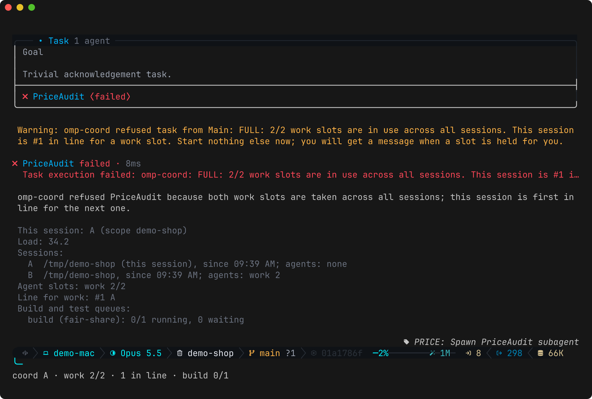

# omp-coord

[](https://github.com/nledford/omp-coord/actions/workflows/ci.yml)
[](https://www.npmjs.com/package/@nledford/omp-coord)
[](https://github.com/can1357/oh-my-pi)
[](LICENSE)

An [omp](https://github.com/can1357/oh-my-pi) plugin, plus a small command-line runner, that lets several omp sessions on one machine, working in the same project, share one set of agent caps and build/test queues, and talk to each other.

- **Shared agent caps.** Subagents count against pools (for example 8 `work` and 2 `short` slots) shared by every session in the project. Spawns past the cap wait in omp's own queue and start by themselves as slots free; one that still reaches omp's spawn check over the cap is refused. The cap does not depend on agents remembering to take and free slots.
- **A fair line.** A refused session joins the line; the next free slot is held for it, and it is told so.
- **Subagents start only reviewers.** "No nested worker agents" is enforced rather than asked for.
- **Build and test queues.** `omp-coord run <queue> -- <command>` waits for one of the queue's slots, then runs the command, within an optional time limit. Agents' matching bash commands are rewritten to go through it.
- **Messages, claims, pause.** Sessions message each other and each other's subagents, claim branches, worktrees and PRs against other sessions' git commands, and pause the whole project at once.
- **Load-aware limits, ports and scratch folders, a decision log, reports** of waits, refusals and agents a crash left mid-run, and an SQLite event log.

Each session gets a letter and shows `coord B · work 5/8 · short 1/2` in omp's footer. Here session B's agents hold both `work` slots, so session A's spawn is refused, A goes first in line, and `/coord` shows the board:



## Quick start

```sh
omp plugin install @nledford/omp-coord
```

Then put a `.omp-coord.json` in the project's top folder:

```json
{
  "scope": "my-project",
  "agents": { "pools": { "work": { "cap": 6 } }, "exempt": ["reviewer"] },
  "queues": { "build": { "slots": 2, "order": "fair-share" } },
  "commands": [{ "pattern": "(^|\\s)npm run build\\b", "action": "queue", "queue": "build" }]
}
```

Every omp session started in that folder or below now shares 6 agent slots, and agents' `npm run build` waits for one of 2 build slots. `/coord` shows the board; `omp-coord doctor` checks the setup. A fuller example: [`examples/omp-coord.json`](examples/omp-coord.json).

## Documentation

| | |
|---|---|
| [Install](docs/install.md) | From npm, GitHub, the marketplace or GitHub Packages; updating; the `omp-coord` command. |
| [Configuration](docs/configuration.md) | Every `.omp-coord.json` field. |
| [Agent slots](docs/agent-slots.md) | How caps, the line, holds and nested agents work. |
| [Queues](docs/queues.md) | `omp-coord run`, order, lanes, time limits, agents' commands. |
| [Working across sessions](docs/coordination.md) | Messages, claims, pause, the decision log, ports, crash recovery. |
| [Commands](docs/commands.md) | `/coord`, agent tools, CLI (`status --json` for scripts), environment variables. |
| [Event log](docs/event-log.md) | The SQLite tables and events, with example queries. |
| [Versioning](docs/versioning.md) | What the version promises; cutting a release. |

[CHANGELOG.md](CHANGELOG.md) lists what each release changed.

## Limits

- The cap is an agreement between sessions, not a security boundary: if the shared board cannot be read, spawns are let through with an error notice.
- Sessions of one scope should read the same `.omp-coord.json`. Two different files under one scope (for example one per worktree) make sessions disagree.
- Claims match command text: a guard against mistakes, not a lock.
- A message is put into the other session's conversation as written. Text an agent copies into a message from an untrusted source reaches the other session too.
- `/tan` clones are subagents to omp, so they take slots from the default pool and fall under the rules for agents started by subagents.
- On one machine only: sessions find each other through a shared folder, not the network.

## Develop

```sh
just install
just fmt     # format with Biome
just check   # typecheck, lint, tests, version files agreeing
just         # every workflow
```

Code layout and conventions: [AGENTS.md](AGENTS.md). License: [MIT](LICENSE).
