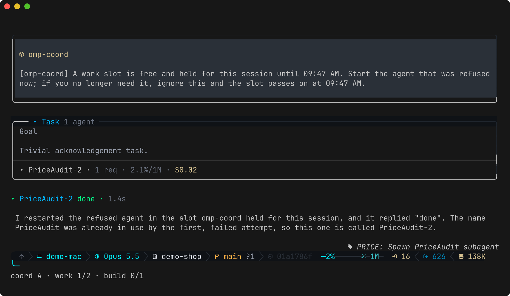

# Agent slots and the line

Subagents count against pools of slots (for example 8 `work` and 2 `short`) shared by every session in the scope. Pools, caps and agent types are set under `agents` in the [configuration](configuration.md).

## How slots are counted

| Event | Effect |
|---|---|
| omp's spawn check approves a subagent | It takes a slot at once (`starting`). |
| The subagent's run starts (`agent_start`) | The slot becomes `running`. |
| The subagent's run ends (`agent_end`: finished, failed or killed) | The slot frees. An idle or parked agent holds no slot. |
| An idle agent is revived (`write agent://…`) | It takes a slot again, even over the cap. omp does not run the spawn check for revivals, and running agents are never stopped; new spawns are refused until the total is under the cap. |
| An approved spawn never starts | Its slot frees after `agents.startTimeoutSeconds`. |
| A session exits or its process dies | All its slots and its place in line go, within about 10 seconds. |

## Spawns wait their turn

With `agents.queueSpawns` (on by default), while a session is the only one in its scope, the extension keeps omp's own per-session spawn queue, the `task.maxConcurrency` setting, at the number of the session's spawns the caps let run now: its top-level agents already running or starting, the default pool's free slots, and one held for it there. Start as many agents as you need: omp starts the ones that fit and keeps the rest waiting in its queue, each starting as one of the session's agents ends. A value you set yourself for `task.maxConcurrency` stays the ceiling (it is read when the session starts). The value is a runtime override, never saved, and it is cleared when the session ends.

When a second session joins the scope, or the scope is paused, the override is cleared and spawns over the cap are refused as described under The line below. omp re-reads its queue size only when the session asks for a spawn or one of its runs ends, and a spawn waiting in omp's queue never reaches the spawn check, so it would never join the line: across sessions, only refusals keep the line fair.

Limits:

- omp's queue holds every agent the main session starts, so a reviewer started by the main session waits its turn too, and an agent of another pool (for example `short`) starts only when a default-pool slot is free as well. Subagents read the same setting, so a worker's own reviewers queue under the same number; with `agents.nested.maxRunningPerParent` at 1 that never delays them.
- Agents started outside omp's queue (revived with `write agent://…`, or a workpool's workers) take slots the queue doesn't see; if they fill every slot, the override is cleared and spawns over the cap are refused.
- A spawn approved but never started holds its slot until `agents.startTimeoutSeconds` runs out; meanwhile one more spawn can reach the spawn check and be refused.

## The line

A spawn over the cap that reaches the spawn check is refused, and the session joins the line for that pool. When a slot frees, it is held for the session refused first (default 5 minutes, `agents.holdMinutes`) and that session is told so; other sessions' spawns are refused meanwhile. A session that does not use its held slot in time loses it to the next in line.

The refusal, as the refused session sees it (here both `work` slots are in use by session B):

When one of B's agents ends, the slot is held for A, which is woken with a notice and starts the refused agent:

omp gives the spawn check 30 seconds and then lets the spawn through, so the extension never waits inside it: spawns wait in omp's queue before the check while the session is alone (above), and one that reaches it over the cap is refused at once, with the next free slot held. If the shared board cannot be read, spawns are let through with an error notice: the cap is an agreement between sessions, not a security boundary.

While the machine's 1-minute load average is above a pool's `loadCaps` threshold, the lower cap applies. Running agents are never stopped; new ones wait until the total is under the lower cap.

## Agents started by subagents

A subagent may start only the agent types listed under `agents.nested.allow` (by default the exempt types, such as reviewers), at most `agents.nested.maxRunningPerParent` at a time, outside the caps. Everything else is refused, so "no nested worker agents" is enforced rather than asked for.

## Exempt agents

Agent types under `agents.exempt` never take a slot. They still start while the scope is paused.
